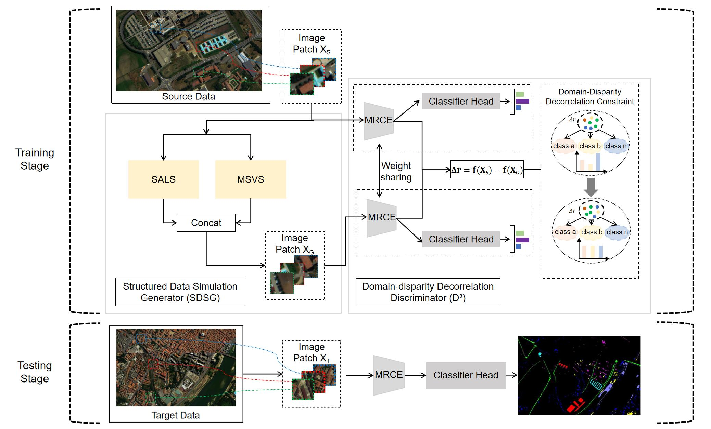

## Hyperspectral single-source domain generalization via structured data simulation and domain-disparity decorrelation

**Haotian Hu, Yunpeng Zheng, Qian Liu, Shuai Yang, Biqi Wang, Xiaohui Yuan, and Lichuan Gu**

*Knowledge-Based Systems*, **348**, 116429, 2026.  
[Paper](https://www.sciencedirect.com/science/article/pii/S095070512601155X) · [DOI: 10.1016/j.knosys.2026.116429](https://doi.org/10.1016/j.knosys.2026.116429)

## Abstract

Cross-scene hyperspectral image (HSI) classification faces significant challenges due to domain shifts arising from structured spectral–spatial variations. While Single-Source Domain Generalization provides a viable pathway by learning from only one source domain, prevailing methods, particularly those built on generative-adversarial strategies, remain constrained by two issues. On the one hand, they predominantly depend on unstructured randomization, which ignores the inherent structured variations of cross-scene HSI. On the other hand, in striving for domain invariance, they tend to enforce strict alignment, which can suppress discriminative intra-domain features that are valuable for classification. To address these challenges, this paper proposes SD³Net, a novel framework grounded in structured data simulation and domain-disparity decorrelation. Specifically, to ensure structural fidelity, we introduce the Structured Data Simulation Generator (SDSG), which shifts data generation method from stochastic perturbation to logic-driven emulation. It consists of a Semantic-Anchored Layout Simulator (SALS) to reorganize spatial topologies based on semantic logic, and a Multi-Scale Spectral Variation Simulator (MSVS) to emulate spectral distortions induced by sensor and atmospheric variations. Meanwhile, to resolve the dilemma between invariance and discriminability, we propose the Domain-Disparity Decorrelation Discriminator (D³). Instead of enforcing strict alignment, this mechanism explicitly models feature residuals between source and simulated domains and maximizes their predictive entropy. This strategy effectively decouples domain-specific disparities from the feature representation while preserving essential intra-domain semantics. Extensive experiments on multiple cross-scene HSI datasets demonstrate that SD³Net significantly outperforms state-of-the-art methods, validating the efficacy of the proposed simulation and decorrelation strategies.

## Citation

```bibtex
@article{Hu2026SD3Net,
  title   = {Hyperspectral single-source domain generalization via structured data simulation and domain-disparity decorrelation},
  author  = {Hu, Haotian and Zheng, Yunpeng and Liu, Qian and Yang, Shuai and Wang, Biqi and Yuan, Xiaohui and Gu, Lichuan},
  journal = {Knowledge-Based Systems},
  volume  = {348},
  pages   = {116429},
  year    = {2026},
  doi     = {10.1016/j.knosys.2026.116429}
}
```

## Overview

SD³Net addresses single-source domain generalization for cross-scene hyperspectral image classification. The framework consists of:

- **Structured Data Simulation Generator (SDSG):** a Semantic-Anchored Layout Simulator (SALS) and a Multi-Scale Spectral Variation Simulator (MSVS).
- **Domain-Disparity Decorrelation Discriminator (D³):** feature extraction with a Multi-Scale Residual Convolutional Encoder (MRCE) and a decorrelation objective based on maximizing the predictive entropy of feature residuals.



*Overall architecture of SD³Net, reproduced from Fig. 1 of the paper.*

## Experimental environment

| Component | Configuration      |
| --- |--------------------|
| Operating system | Ubuntu 22.04.5 LTS |
| Python | 3.8.20             |
| PyTorch | 2.4.1              |
| GPU | NVIDIA RTX 3090 Ti |

## Datasets


| Dataset | Source scene → target scene |
| --- | --- |
| Pavia | Pavia University → Pavia Centre |
| HyRANK | Dioni → Loukia |
| WHU-Hi | HongHu → HanChuan |

```text
datasets/
├── Pavia/
│   ├── paviaU.mat
│   ├── paviaU_7gt.mat
│   ├── paviaC.mat
│   └── paviaC_7gt.mat
├── HyRANK/
│   ├── Dioni.mat
│   ├── Dioni_gt_out68.mat
│   ├── Loukia.mat
│   └── Loukia_gt_out68.mat
└── WH/
    ├── WHU_Hi_HongHu.mat
    ├── WHU_Hi_HongHu_gt.mat
    ├── WHU_Hi_HanChuan.mat
    └── WHU_Hi_HanChuan_gt.mat
```

## Training
The paper reports these dataset-specific settings in **Table 5**:

| Dataset | Patch size | λ₁ | λ₂ | λ₃ |
| --- | --- | --- | --- | --- |
| Pavia | 13 × 13 | 0.1 | 1 | 1 |
| HyRANK | 7 × 7 | 0.1 | 0.1 | 1 |
| WHU-Hi | 7 × 7 | 0.1 | 0.3 | 1 |

## Source layout

```text
KBS_SD3Net/
├── train.py
├── datasets.py
├── utils_HSI.py
├── con_losses.py
├── network/
│   ├── generator.py
│   ├── discriminator.py
│   └── morph_layers2D_torch.py
├── datasets/
│   ├── Pavia/
│   ├── HyRANK/
│   └── WH/
├── figure/
│   └── sd3net_framework.jpg
├── .gitignore
└── README.md
```

